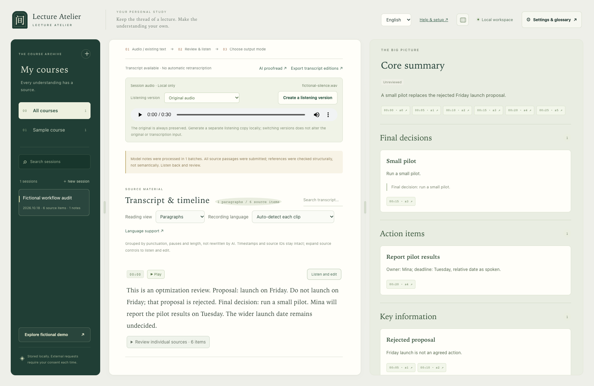

# 听课之间 · Lecture Atelier

把课程、讲座或会议的**录音／文字稿，变成可回听、可修改、可导出的文稿与笔记**。在自己的电脑上运行，通过浏览器使用。

[English](README.md) · [下载](https://github.com/Acalephe0214/lecture-atelier/releases) · [开始使用](#start) · [完整流程](#workflow) · [通义听悟怎么用](#tingwu)

## 输入什么？输出什么？能做什么？

- **输入：** 一份录音或视频，或者已有的 TXT、SRT、VTT、受支持的 JSON 转写稿。也可以同时提供录音和文字稿。
- **输出：** 可编辑的转写稿；可选 AI 校对建议、详细笔记和总结总览；可下载的 Word、PDF、Markdown、TXT、JSON 或字幕文件，具体格式取决于导出内容。
- **功能：** 音视频转文字 → 边听边改 → 审阅 AI 修改 → 按课程／讨论／会议整理 → 回查出处 → 导出文件或发送到 Notion。各步骤可以单独使用，不必全部开启。

**不配置 AI 也能用。** 导入、手工修改和非 PDF 本地导出不需要 API。只有本地识别需要安装语音组件；AI 校对和总结需要配置模型接口。

## 要填什么，才能使用？

| 想做的事 | 需要提供或配置什么 |
| --- | --- |
| 导入已有稿、手工校对、导出 | 新建课程／课次，选择文字稿；要回听就再添加同一份录音。不需要 API key。 |
| 只有录音，在本机转文字 | 添加录音、选择实际录音语言，先安装 `speech` 组件。不需要语音 API key。 |
| 用通义听悟转文字，再导回 | 在听悟网页登录自己的账号、确认录音上传，再下载并导入完整文字稿。本 App 不要求填写听悟账号或阿里云 AccessKey。 |
| AI 校对、生成总览和笔记 | 在「设置与术语表 → LLM」填写服务商提供的 **API 地址、准确的模型 ID、API key**。不是品牌名称或网页登录密码。 |
| 发送笔记到 Notion（可选） | 填写 **Notion connection token、目标父页面链接／ID**，并在 Notion 授权该 connection 访问父页面。这与模型 API key 是两套配置。 |

**想先看看效果？** 启动后点「探索虚构示例」，不需要准备账号、密钥或自己的录音，就能试阅读、修改和导出。运行应用需要 Python，安装方法见下方。

右上角「流程地图」可查看五个步骤、对应按钮和每步产物。左侧「管理课程」、中间「课次选项 → 移除课次」及「移除录音」会把选中记录移入本地「回收站」，可以恢复。移除录音关联时，文字稿、笔记及原文件保留。



<a id="start"></a>

## 第一次启动

1. 在 [Releases](https://github.com/Acalephe0214/lecture-atelier/releases) 下载 **`LectureAtelier-<版本号>.zip`** 并完整解压。这是使用包，首次使用不必选开发者源码包。
2. **Mac：** 打开 `LectureAtelier.app` 或 `launch.command`。**Windows 10/11 x64：** 打开 `launch-windows.bat`。
3. 浏览器打开 <http://127.0.0.1:8767/>。右上角可选中文或 English。点「探索虚构示例」，试着改一句原文、保存、刷新，再导出 TXT。示例不是模型质量评测。

已有 Python 3.10+ 时，也可在项目目录运行：

```sh
python3 app.py --open
```

Windows 命令行可用 `py -3 app.py --open`。缺少 Python 时，启动器会引导确认下载项目本地运行环境；**基础模式不下载 Whisper 模型**。这是源码式本地应用，不是已签名、所有依赖都预装好的原生安装包。

需要更多功能时，Mac 打开 `setup-mac.command`，Windows 打开 `setup-windows.bat`：

| 安装选项 | 用途 |
| --- | --- |
| `basic`（默认） | 导入、阅读、手工校对和非 PDF 导出；仅在缺少 Python 时下载运行环境。 |
| `speech` | 本机 Whisper 转写。安装语音／媒体组件，未配置语音后端时下载模型。 |
| `pdf` | PDF 导出依赖，不安装语音模型。 |
| `full` | 本地转写和 PDF。 |

语音安装可能需下载约 0.5–1.5 GB、预留 2–4 GB 磁盘；已有语音配置会保留。详细安装说明：[中文手册](FRIEND-GUIDE.html) · [English guide](FRIEND-GUIDE-EN.html)。

<a id="workflow"></a>

## 完整流程：从材料到笔记

```text
已有文字稿 ──────────────────┐
录音／视频 → 本地 Whisper ───┤
录音／视频 → 听悟网页 → 导入 ─┘
                            ↓
                可回听、可修改的转写稿
                            ↓
                 可选：AI 校对 → 人工确认
                            ↓
                 可选：AI 总览与详细笔记
                            ↓
                  核查出处 → 导出／Notion
```

### 1. 新建课次，添加材料

左侧新建课程，再新建课次，填写标题、日期。会议也可以这样建立一条记录。添加对应录音或视频；文件先保存在本机，**添加文件不等于同意上传云端**。

选择实际录音语言；混合语言可以选择组合，例如法语＋越南语。录音语言、界面语言、笔记输出语言分别设置，切换英文界面不会翻译原稿。

### 2. 得到文字稿：任选一条路线

**已经有稿：** 点「导入转写稿」，选择文件或粘贴全文。支持 TXT、SRT、VTT、segments JSON 和受支持的听悟 Transcription JSON，不需要再识别全文。想按时间码回听，优先导入带真实时间戳的稿并配上同一录音；普通 TXT 不会被编造时间码。

**在本机转写：** 先安装 `speech`，点「选择转写路线 → 本地 Whisper」，确认语言后开始。首次安装需要联网；模型就绪后的本地识别不上传录音。视频会先提取并缓存音轨，原文件保留。界面显示进度和缺口，可局部补转、比较候选并确认采用，也可回听后手工补字；重试有次数限制，不保证所有片段都能自动识别正确。

**用通义听悟：** 允许把录音交给外部服务时，可在听悟转写再导回，见[具体步骤](#tingwu)。另有「已配置 ASR 接口」路线，供已有兼容语音网关的用户使用；它需要另行配置、外发录音确认，可能收费，不是必选项。

### 3. 回听和修改；需要时再用 AI 校对

中间「原文与时间线」可选段落阅读或逐句时间线。点击时间码定位录音，再点「边听边改」或「校对」。正常段落也能修改，原始转写、来源编号和修改记录会保留；没有可靠时间码时不能准确按句跳转。

要让 AI 检查术语或明显错句：

1. 在「设置与术语表 → LLM」填 API 根地址、模型 ID 和密钥。程序追加 `/chat/completions`，不要重复填这个后缀。
2. 点「AI 校对稿」，填话题／领域、相关术语或姓名拼写，确认发送文字。
3. 逐项或批量接受／拒绝带标记的建议，不确定之处继续回听。

**AI 校对不是重新听录音：** 这一步发送文字和背景，不上传音频，也不能保证修订内容就是原话。

### 4. 选择用途和语言，生成笔记

右侧选择「课程精读」「讲座速览」「课堂讨论」「会议纪要」或自定义用途，再选笔记输出语言：中文、英文、法语、德语、越南语、日语或跟随原文。只影响下次 AI 生成，不修改已有稿或笔记。

点「AI 总览与详细笔记」，查看用量预估并确认运行。界面显示阶段进度和接口已报告的 token；估算不是费用上限，实际费用以服务商账单为准。

**生成中途失败怎么办？** 成功的详细笔记批次和总览分组会保存为本地断点。「从断点继续」会重新校验并复用完全匹配的结果，本次 token 统计只计算新请求。已完成的详细笔记也会保留为可下载草稿，点「采用已完成笔记」可单独保存；替换前当前笔记保持原样。修改原文、提示词、输出语言、模型或接口地址后，受影响的断点会失效。失败请求仍可能计费；旧版本已丢弃的返回内容无法靠新断点机制恢复。

- **总结总览：** 全局重点；会议模式还区分明确决策、行动和未决问题。被否决的建议不能当作最终决定。
- **详细笔记：** 按用途展开概念、论证、讨论或议题，附原文来源，方便回查。
- **仅补生成总览：** 保留已有详细笔记，仅重新综合总览；需要先有可综合的笔记。

「其他工具 → 原句复制卡片」只是复制原文，不调用模型、不会概括，也不等于 AI 笔记。

### 5. 核查，导出或发送到 Notion

点击来源回到原文，检查术语、遗漏、观点归属、决策和负责人等，再标记核查状态。**有出处不等于总结一定正确。** 修改原文后，相关笔记可能需要重新核查。

- **完整文稿：** 中间点「导出校对稿」，选校对前原稿（此次 AI 校对前快照）、带标记稿或校订稿。校订稿只含已接受修改；阅读版会合并段落，方便连续阅读。
- **笔记与总览：** 右侧「导出」可选 Word、Markdown、JSON、PDF 等相应格式。PDF 需要 `pdf` 组件；字幕导出需要真实时间码。
- **Notion 页面：** 配好 connection token 和有写入权限的父页面，点「发送到 Notion」并确认。每次新建子页面，不上传录音，不是双向同步。

<a id="tingwu"></a>

## 通义听悟怎么用？

使用[听悟应用网页](https://tingwu.aliyun.com/home)，**不需要为这条路线开通阿里云开发者 API**。官方也区分个人网页使用和企业接口接入，见[产品说明](https://help.aliyun.com/zh/tingwu/product-introduction/)。网页入口、导出选项、语言和额度可能变化，以当前账号页面为准；不保证免费额度或识别效果。

### 自己操作网页

1. 在本 App 的目标课次添加录音，点「选择转写路线 → 通义听悟 · 浏览器协助」，确认生成操作说明。此时仅**已准备，尚未上传**。
2. 点「打开通义听悟」，在网页登录自己的账号。扫码、验证码、账号选择由你完成。本 App 不保存听悟密码或 Cookie。
3. 找到网页当前的音视频上传／文件转写入口，选择**这一份录音**。检查语言、文件限制、额度和费用，确认你有权外发后提交。这条云端路线确实会把录音传给听悟。
4. 等待完成，打开**完整转写正文**。不要用摘要、章节速览或润色总结代替原稿。
5. 从网页实际提供的导出选项中，优先下载带时间戳的 **SRT**；没有则用 **TXT**。已有官方 Transcription JSON 时可导入受支持的结构。Word 不是本 App 的转写输入格式，必要时先取出正文另存 TXT。
6. 回到本 App **同一课次**，点「导入已下载的文字稿」或「导入转写稿」，来源选「通义听悟」，选择刚下载的文件并导入。
7. 检查文字、时间戳与本地录音是否对应。已有稿时先备份，再确认替换：旧稿和笔记保留在 JSON 导出的历史中，但当前没有一键恢复转写功能。之后直接校对和整理，**不用再跑完整的本地 Whisper**。

也可以先独立使用听悟，再来本 App 新建课次、添加同一录音并导入结果；应用内交接步骤并非必需。

### 让浏览器助手协助

在交接窗口点「复制给浏览器 AI」，把说明交给**确实有浏览器和本地文件上传能力、且你信任的助手**。说明含录音路径和返回课次地址；没有相应能力的聊天模型不能代替你操作网页。

App 不会自行启动助手、登录或上传。你仍需完成账号验证并确认外发；额度不足或出现新增费用时停下确认，不自动购买。说明含私人路径，不要贴到公开仓库或 Issue。下载完成后仍按上面第 6—7 步导回检查。

## 数据、限制和更多说明

录音、转写、修改和笔记默认保存在本机 `.runtime/`，服务仅监听 `127.0.0.1`。本地 Whisper 不上传录音；AI 校对／总结发送相应文字到你配置的服务；听悟或语音网关接收录音；Notion 接收你确认导出的笔记。密钥本地保存，未做应用层加密。见 [隐私说明](PRIVACY.md)。

当前为 alpha。自动化检查主要验证软件流程，不是代表性准确率评测；全新 Windows 用户安装、真实转写和总结质量仍需更多验证。不支持 Windows ARM64。课件／个人笔记辅助上传仍是计划功能。见 [验证范围](docs/VERIFICATION.md) 和 [路线图](docs/ROADMAP.md)。

[架构说明](docs/ARCHITECTURE.md) · [首次试用清单](docs/TRY-IT.md) · [源码打包](docs/PUBLISHING.md) · [问题反馈](https://github.com/Acalephe0214/lecture-atelier/issues/new/choose)

## 许可

项目源码采用 [MIT](LICENSE)。Whisper 等第三方软件和模型保持各自许可，见 [第三方声明](THIRD-PARTY-NOTICES.txt) 与 [许可证副本](licenses/README.md)。仓库和源码包不附带第三方运行环境、模型权重或字体。项目使用 AI 辅助开发，本地识别接入上游 Whisper 实现。
